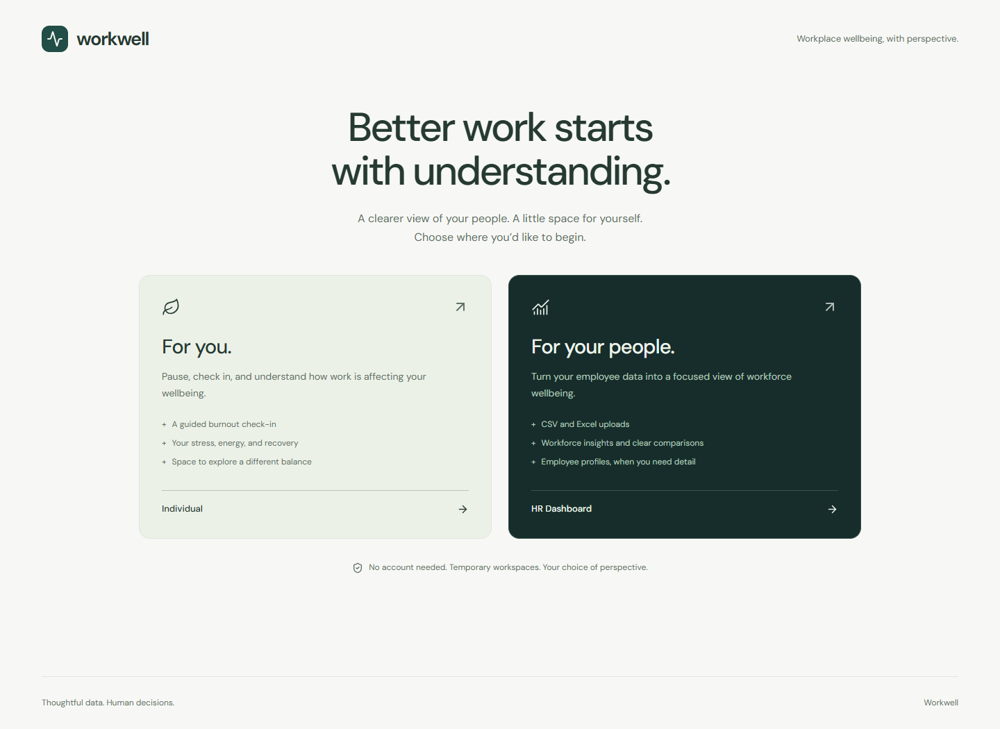
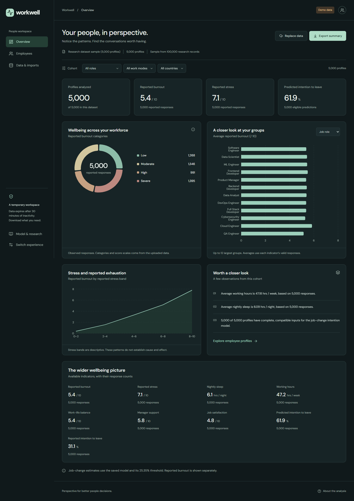
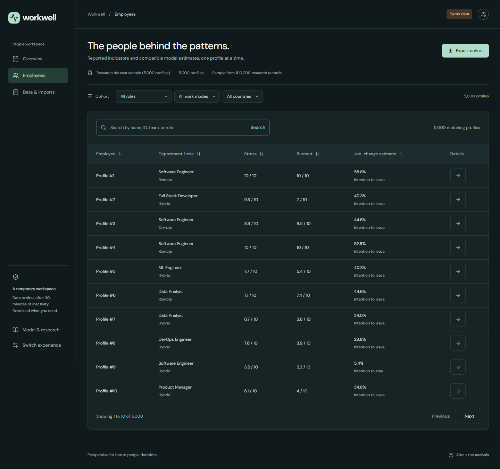
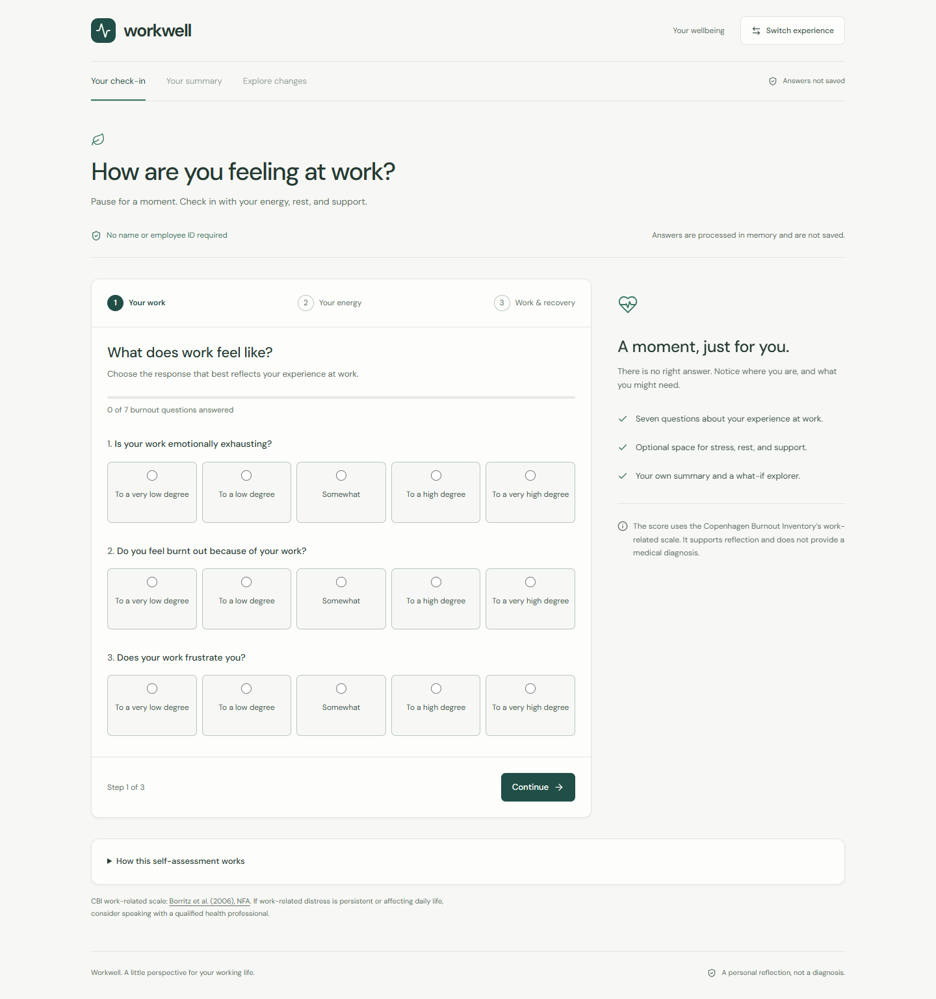
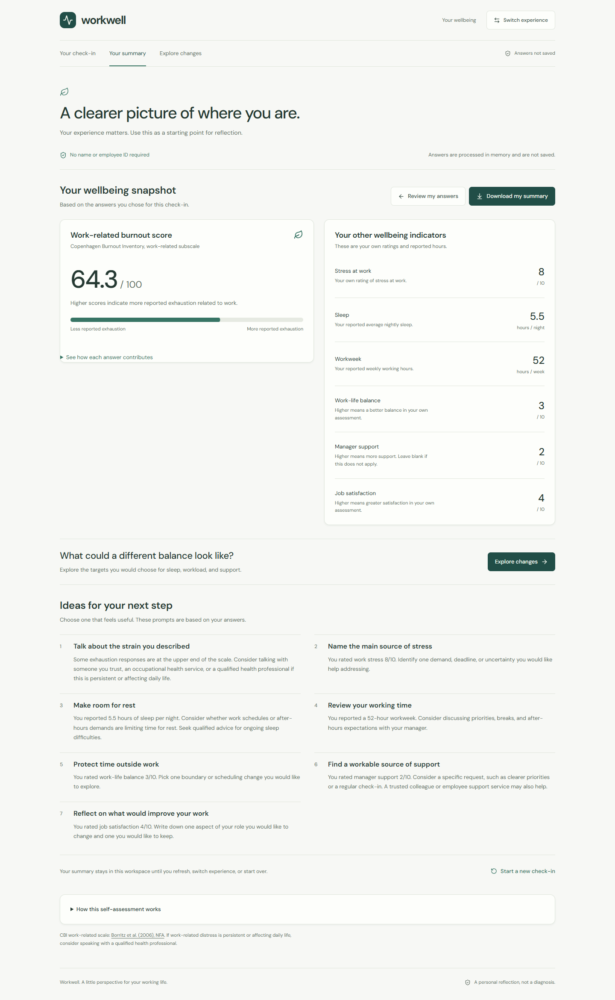
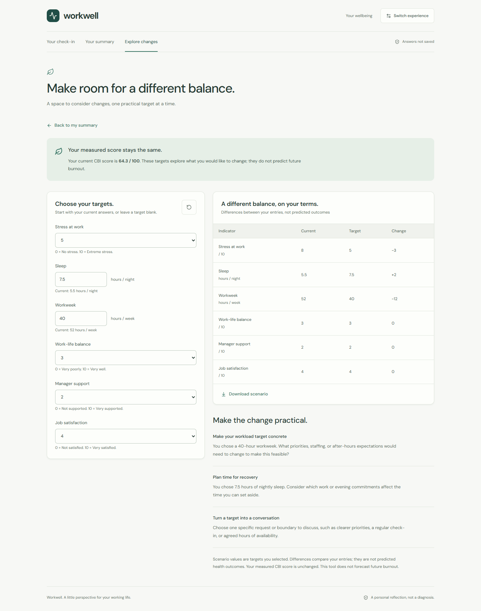
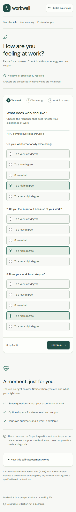
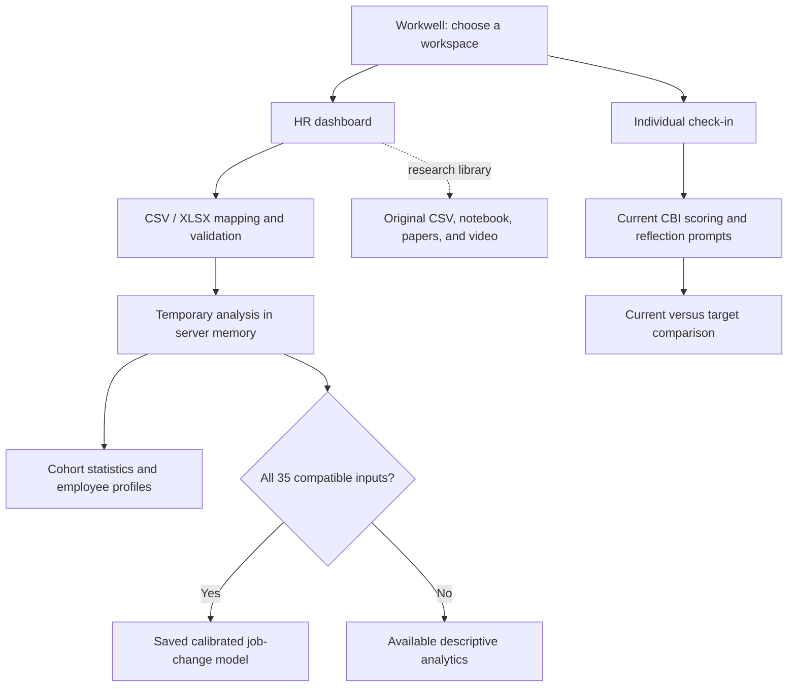

# Workwell

### Workplace wellbeing, with perspective.

Workwell turns a mental workload and turnover research project into two web experiences: a focused **HR analytics dashboard** and a personal **burnout and wellbeing check-in**. Built with Vite, React, TypeScript, and FastAPI, it serves actual dataset statistics, the supplied saved model's outputs, and an explained questionnaire score through one application.

**Two workspaces · CSV and Excel analysis · Interactive charts · Original model inference · CBI self-assessment**



> **Understanding the outputs:** the saved machine learning model estimates **self-reported job-change intention**. The individual check-in measures **current work-related exhaustion using the CBI**. What-if targets compare chosen inputs and leave the measured score unchanged. These outputs do not establish actual departure, a clinical diagnosis, or future burnout probability.

## Contents

- [Product overview](#product-overview)
- [Screenshots and sample analysis](#screenshots-and-sample-analysis)
- [Quick start](#quick-start)
- [GitHub Pages hosting](#github-pages-hosting)
- [Using the application](#using-the-application)
- [Dataset and data dictionary](#dataset-and-data-dictionary)
- [Research and model methodology](#research-and-model-methodology)
- [Individual assessment methodology](#individual-assessment-methodology)
- [Architecture and technology](#architecture-and-technology)
- [API reference](#api-reference)
- [Testing and reproducibility](#testing-and-reproducibility)
- [Research files and documentation](#research-files-and-documentation)
- [Privacy and deployment boundaries](#privacy-and-deployment-boundaries)
- [References and attribution](#references-and-attribution)

## Product overview

The first screen lets users choose the experience that fits their role. Each workspace has its own layout, navigation, and state.

| | HR Dashboard | Individual |
| --- | --- | --- |
| Audience | HR professionals and people analytics teams | Employees reflecting on their wellbeing |
| Entry route | `/hr` | `/individual` |
| Interface | Dark dashboard with cohort analytics | Light, guided check-in |
| Inputs | CSV/XLSX employee data, or an explicitly selected research sample | Seven CBI responses and six optional wellbeing indicators |
| Main outputs | Statistics, charts, group comparisons, employee profiles, eligible job-change predictions | Current exhaustion score, reported indicators, reflection prompts, what-if comparisons |
| Downloads | Summary, employee, and validation issue CSVs | Personal summary and scenario text files |
| Retention | Temporary server memory with inactivity expiry | Workspace memory; cleared on refresh, switching experience, or reset |

### HR capabilities

- Upload CSV or Excel files, select a worksheet, and confirm suggested column mappings.
- Review valid/rejected rows and download issues before accepting an analysis.
- Analyze partial wellbeing data without filling missing inputs with invented defaults.
- Filter cohorts by available department, team, role, country, work mode, and predicted class.
- Explore reported burnout distributions, group averages, stress relationships, and response counts.
- Search, sort, paginate, and inspect individual employee profiles.
- Run the original saved model for profiles with all **35 compatible raw inputs**.
- Export results and explicitly clear or replace the temporary analysis.
- Access original papers, notebook, video, model provenance, and the advanced prediction sandbox.

### Individual capabilities

- Complete a three-stage check-in covering work, energy, and recovery.
- Receive a correctly scored seven-item CBI work-related exhaustion score with an expandable item breakdown.
- Optionally report stress, sleep, working hours, work-life balance, manager support, and job satisfaction.
- Read transparent, rule-based reflection prompts and download a personal summary.
- Compare current values with chosen targets in the what-if explorer, then export the scenario.
- Start a fresh check-in without entering a name, employee ID, or demographic profile.

## Screenshots and sample analysis

These are **screenshots of the running application**, captured through its real interface. HR images use the built-in demo: the **first 5,000 rows** of the supplied 100,000-record CSV, with predictions generated by the supplied artifact. Individual images use fictional illustrative answers submitted through the questionnaire. No real employee check-in is shown.

### HR dashboard: actual research sample



| Indicator in this screenshot sample | Value | Responses |
| --- | ---: | ---: |
| Profiles analyzed | 5,000 | 5,000 |
| Mean reported burnout | 5.42 / 10 | 5,000 |
| Mean reported stress | 7.06 / 10 | 5,000 |
| Mean nightly sleep | 6.09 hours | 5,000 |
| Mean weekly working time | 47.18 hours | 5,000 |
| Reported job-change intention | 31.06% | 5,000 |
| Classified as job-change intention by the saved model | 61.90% | 5,000 eligible profiles |

The last row is the fraction classified positive at the saved **25.35% probability threshold**, not the mean predicted probability or an observed departure rate. Its difference from reported intention reflects model errors and the chosen operating threshold. These sample figures differ from the full-dataset statistics below. Capture details and exact counts are recorded in [screenshot provenance](docs/screenshots/provenance.json).

<details>
<summary>View the HR employee explorer</summary>



The list and employee detail pages use the same selected analysis as the dashboard.

</details>

### Individual check-in



### Individual summary



The illustrative answers produce **64.29/100**, displayed as **64.3**. Optional ratings and hour values are reported separately from the CBI score.

<details>
<summary>View the what-if explorer and mobile interface</summary>



Targets in this example change sleep from 5.5 to 7.5 hours and working time from 52 to 40 hours per week. The current measured CBI score stays unchanged.



</details>

To reproduce the images, start the development servers and run:

```powershell
node scripts/capture_readme.mjs
```

The script uses installed Google Chrome and defaults to `http://127.0.0.1:5173`. Set `WORKWELL_URL` to capture a different local instance. Images live in [docs/screenshots](docs/screenshots); capture does not change application source or train a model.

## Quick start

### Requirements

- **Node.js 22.12+** and npm; Node.js 24 is also suitable.
- **Python 3.10–3.13**, with **3.12 recommended** for the supplied model environment.
- The seven [original research assets](#original-research-assets) in the project root.
- Google Chrome for browser tests and the screenshot script.

The model is pinned to **scikit-learn 1.6.1**. Python 3.14 is outside this project's supported model environment. Saved scikit-learn objects require compatible dependencies; see the official [model persistence documentation](https://scikit-learn.org/1.6/model_persistence.html).

### Windows: build and serve together

From the project directory:

```powershell
.\start.ps1
```

Alternatively, double-click [start.cmd](start.cmd). The script creates `.venv` if needed, installs backend dependencies, installs frontend packages when absent, builds the UI, and starts FastAPI.

| Service | URL |
| --- | --- |
| Application | http://127.0.0.1:8000 |
| Interactive API documentation | http://127.0.0.1:8000/docs |
| Health check | http://127.0.0.1:8000/api/health |

Keep the terminal open; press **Ctrl+C** to stop. Useful options:

```powershell
# Choose a compatible Python executable
.\start.ps1 -Python 'C:\Path\To\Python312\python.exe'

# Reuse an existing production build
.\start.ps1 -SkipBuild

# Serve on another port
.\start.ps1 -Port 8001
```

### Development: frontend and backend separately

Install dependencies once:

```powershell
python -m venv .venv
.\.venv\Scripts\python.exe -m pip install -r requirements-dev.txt
npm ci
```

**Terminal 1 — FastAPI, with backend reload:**

```powershell
.\.venv\Scripts\python.exe -m uvicorn backend.main:app --reload --reload-dir backend --host 127.0.0.1 --port 8000
```

**Terminal 2 — Vite, with frontend hot reload:**

```powershell
npm run dev -- --port 5173 --strictPort
```

Open **http://127.0.0.1:5173**. Vite proxies `/api` and `/resources` to FastAPI on port 8000. The frontend needs no API keys or external font service. For combined serving, run `npm run build` before starting FastAPI so it can mount `dist/assets`.

On macOS/Linux, create the environment with `python3 -m venv .venv` and substitute `.venv/bin/python` for `.venv\Scripts\python.exe`. The Windows startup scripts are platform-specific.

### Optional container

```sh
docker build -t workwell .
docker run --rm -p 127.0.0.1:8000:8000 workwell
```

The [Dockerfile](Dockerfile) builds the frontend with Node.js 22 and serves it with Python 3.12. Container execution has not been verified in this workspace.

## GitHub Pages hosting

The [Pages workflow](.github/workflows/pages.yml) runs on **every push** and supports manual runs. Every branch/tag push builds the frontend; successful default-branch pushes publish it to GitHub Pages. In repository **Settings → Pages**, choose **GitHub Actions** as the source, then push or rerun the workflow.

Pages builds use the correct repository asset path and hash routes such as `/#/hr`, so navigation and refreshes work on a static host. Local development and combined FastAPI serving retain clean routes.

**GitHub Pages hosts the frontend only.** There is no public backend URL configured yet. Live HR analysis, individual assessment results, predictions, and research downloads require a separately hosted FastAPI service. When it is available, add the public HTTPS URL as the repository Actions variable **`WORKWELL_BACKEND_URL`** and set **`WORKWELL_ALLOWED_ORIGINS`** on that backend to the Pages origin. Rebuild after changing the frontend URL.

See [GitHub Pages setup](docs/GITHUB_PAGES.md) for the one-time settings, backend connection, permissions, URLs, and troubleshooting. The workflow follows the official [Vite Pages guidance](https://vite.dev/guide/static-deploy#github-pages) and [GitHub custom workflow documentation](https://docs.github.com/en/pages/getting-started-with-github-pages/using-custom-workflows-with-github-pages).

## Using the application

### Analyze a workforce file

1. Choose **HR Dashboard**, then **Upload your data**. The initial overview contains no research metrics until a source is chosen.
2. Select a UTF-8 comma-separated CSV or `.xlsx` workbook. Limits are **10 MB**, **5,000 nonempty employee rows**, and **200 columns**.
3. Choose the worksheet, review suggested mappings, and ignore unrelated columns. At least one usable wellbeing indicator is needed. Names, departments, and teams are optional.
4. Declare the burnout score's source scale. Dataset burnout **0–10** and CBI **0–100** are stored as separate measures.
5. Review validation. Download issues and correct the file, or explicitly accept excluding rejected rows.
6. Create the dashboard, filter the cohort, inspect employees, and download results before the temporary analysis expires.

Partial files support descriptive analytics. Predictions require all 35 original fields within compatible categories and ranges. Missing values remain missing, and each metric shows its actual response count. Charts requiring unavailable indicators are omitted. Uploading a new file replaces the active analysis only after successful analysis.

To explore immediately, choose **Explore demo data**. This creates a clearly labeled 5,000-profile research sample.

### Complete a personal check-in

1. Choose **Individual**.
2. Answer the seven required CBI work-related questions across the first two stages.
3. Provide any of the six optional wellbeing indicators in the third stage, or leave them blank.
4. Review the current score, answer breakdown, indicators, and prompts. Download the summary if useful.
5. Choose **Explore changes** to compare optional targets with current inputs. Download the scenario, review answers, or start again.

Results and the explorer require a completed assessment. Direct links without current answers return to the check-in. Individual answers never become HR records or inputs to the saved job-change model.

## Dataset and data dictionary

The local [mental_health_burnout_tech_2026.csv](mental_health_burnout_tech_2026.csv) contains **100,000 records and 36 columns**: **35 raw inputs plus `job_change_intention`**. The paper attributes the source dataset to **Mohan Krishna Thalla**, *Mental Health & Burnout in Tech Workers 2026*, on [Kaggle](https://www.kaggle.com/datasets/mohankrishnathalla/mental-health-and-burnout-in-tech-workers-2026). The supplied methodological report describes it as synthetic; the app does not independently establish its collection process or treat it as a live organization's workforce. See [project analysis](docs/PROJECT_ANALYSIS.md) and the [supplied report](Broad%20Research%20for%20Improving%20Turnover%20Prediction%20Models.pdf).

### Full-dataset profile

| Property | Verified local value |
| --- | ---: |
| Records / columns | 100,000 / 36 |
| Raw categorical / numeric inputs | 10 / 25, including numeric reference ID |
| Unique employee reference IDs | 100,000 |
| Missing cells / duplicated full rows | 0 / 0 |
| Countries / job roles / work modes | 10 / 12 / 3 |
| Target 0: intention to stay | 67,998 (67.998%) |
| Target 1: job-change intention | 32,002 (32.002%) |
| Mean reported stress | 7.0554 / 10 |
| Mean reported burnout | 5.4017 / 10 |
| Mean nightly sleep | 6.1024 hours |
| Mean weekly working time | 47.1041 hours |

These figures describe the complete CSV. They are descriptive observations, not model outputs, clinical prevalence estimates, or the smaller screenshot sample. Source metadata is available in [data-and-model.json](docs/source-analysis/data-and-model.json).

| Reported source burnout category | Records | Share |
| --- | ---: | ---: |
| Low | 25,807 | 25.807% |
| Moderate | 26,255 | 26.255% |
| High | 19,362 | 19.362% |
| Severe | 28,576 | 28.576% |

Source category labels are retained as reported; they are not CBI diagnostic categories. A known consistency issue affects **18,101 records**, where company tenure exceeds total experience. This is documented rather than silently rewritten.

### Input coverage

| Area | Example fields |
| --- | --- |
| Reference and demographics | Employee ID, age, gender, country |
| Employment context | Role, seniority, experience, tenure, company size, industry, work mode, salary, team size |
| Work and recovery | Work hours, meetings, sleep, exercise, vacation |
| Support and resources | Therapy access/use, AI tool use, manager/social support, support-seeking |
| Work experience | Balance, satisfaction, deadline pressure, autonomy, stress, burnout |
| Supplied questionnaire indicators | PHQ-9/GAD-7 scores and categories, reported burnout category |

The [complete data dictionary](docs/DATA_DICTIONARY.md) lists **every column**, its stored type, role, observed range or categories, optional HR-only fields, and the engineered features. PHQ-9/GAD-7 fields are supplied model inputs; the individual interface does not administer those questionnaires or infer their values.

## Research and model methodology

The research compares **Random Forest (RF)** and **Histogram-based Gradient Boosting (HistGB)** for job-change intention using mental workload indicators. The original work is credited to **Yelmi, Kusrini, and Indra Gunawan**, published in *JIIFKOM*, **5(2), 7–16 (2026)**. See the [publisher record](https://jiifkom.utrcepu.ac.id/index.php/jiifkom/article/view/725), [DOI](https://doi.org/10.51901/jiifkom.v5i02.725), and [supplied English rendering](Comparative%20Analysis%20of%20Tuned%20Random%20Forest%20and%20Hist%20Gradient%20Boosting.pdf). The application implementation is separate from authorship of those materials.

### Experimental workflow

The [notebook](Mental_burnut_and_turn_over_latest.ipynb) records baseline RF/HistGB experiments with an 80/20 stratified split, followed by SMOTE comparisons. Its optimized stage uses:

1. Dynamic categorical detection, dense one-hot encoding, and numeric passthrough.
2. A stratified split of **69,997 training**, **15,003 validation**, and **15,000 test** records, with random state 42.
3. Optuna optimization with **three-fold stratified CV**, **12 HistGB trials**, and **10 RF trials**, using balanced class weights.
4. Isotonic probability calibration on the validation fold.
5. F1-based threshold search over 100 values between 0.1 and 0.9.
6. Selection of the candidate with the higher test F1 and export of its calibrated pipeline and metadata.

Training is not performed at app startup. The backend loads the supplied artifact and reproduces its preprocessing for inference.

### Recorded notebook results

| Experiment | Accuracy | F1 | ROC AUC | Test records |
| --- | ---: | ---: | ---: | ---: |
| Random Forest baseline | 68.52% | 25.51% | 0.6680 | 20,000 |
| HistGB baseline | 69.25% | 27.90% | 0.6817 | 20,000 |
| Random Forest + SMOTE | 67.30% | 35.87% | 0.6592 | 20,000 |
| HistGB + SMOTE | 68.98% | 32.66% | 0.6782 | 20,000 |
| HistGB optimized | 56.85% | 53.99% | 0.6859 | 15,000 |
| Random Forest optimized | 55.96% | 53.69% | 0.6807 | 15,000 |

**Source:** saved outputs in the [notebook](Mental_burnut_and_turn_over_latest.ipynb), parsed by [backend/service.py](backend/service.py). Baseline/SMOTE and optimized experiments use different test partitions, so this is not a controlled comparison on a shared holdout. The paper reports optimized HistGB F1 of **52.60%**; the notebook and artifact reproduce **53.99%**. Those separate results are not substituted for one another.

### Saved model and reproduced evaluation

| Item | Value |
| --- | --- |
| Artifact | [turnover_pipeline.pkl](turnover_pipeline.pkl) |
| Selected estimator | Calibrated HistGradientBoosting |
| Serialization | Joblib dictionary containing pipeline, feature lists, and threshold |
| scikit-learn version | 1.6.1 |
| Raw / engineered inputs | 35 / 2; 37 columns before one-hot expansion |
| Decision threshold | 0.2535353535353535 |
| Reconstructed original test records | 15,000 |
| Reproduced accuracy | 0.5684666667 |
| Reproduced F1 | 0.5399104414 |
| Reproduced ROC AUC | 0.6858837214 |

The [verification script](scripts/verify_model.py) evaluates the saved artifact on the reconstructed original test partition **without retraining**. Exact values and artifact SHA-256 are in [verified-model.json](docs/source-analysis/verified-model.json).

| Actual / predicted | Predicted stay intention | Predicted job-change intention |
| --- | ---: | ---: |
| Actual stay intention | 4,729 | 5,471 |
| Actual job-change intention | 1,002 | 3,798 |

This reproduces an existing evaluation, not an independent external validation. Positive classification uses the saved threshold, not an arbitrary 0.5 boundary, and can occur at a probability below 50%.

### Preprocessing compatibility and known limitations

The backend recreates the notebook's engineered inputs:

```python
df["work_hours_to_sleep_ratio"] = df["work_hours_per_week"] / (
    df["sleep_hours_per_night"] * 7 + 1e-5
)

mental_components = [
    "stress_score", "job_burnout_score", "depression_score", "anxiety_score"
]
existing = [name for name in mental_components if name in df.columns]
df["total_mental_load"] = df[existing].sum(axis=1)
```

Only `stress_score` exists under those exact names in the CSV, so **`total_mental_load` equals `stress_score`** for this artifact. This naming defect is preserved to match training; correcting it requires a new training run and artifact. See [serving code](backend/service.py) and [research analysis](docs/PROJECT_ANALYSIS.md).

Other material limits are:

- The target is stated intention, with no observed departure outcome or future burnout horizon.
- Candidate selection uses test F1, and calibration and threshold selection share a validation fold.
- Reference ID, demographics, and overlapping score/category fields remain inputs; suitability, leakage, and fairness need review before operational use.
- Papers contain differing class-ratio statements; the CSV determines the documented 67.998%/32.002% split.
- CatBoost/LightGBM, further cost-sensitive methods, and external explanations in the methodological report are research directions, not additional shipped models.
- Descriptive stress/exhaustion relationships do not establish cause or intervention effectiveness.

## Individual assessment methodology

The individual workflow uses the **seven-item work-related subscale of the Copenhagen Burnout Inventory (CBI)**. The official [NFA English questionnaire](https://nfa.dk/media/a4wheblj/cbi-scales.pdf) supplies the items and scoring; [NFA's usage page](https://nfa.dk/vaerktoejer/spoergeskemaer/spoergeskema-til-maaling-af-udbraendthed-cbi/copenhagen-burnout-inventory-cbi) specifies attribution. The personal/client-related subscales are not administered.

### Scoring

- Each response contributes **0, 25, 50, 75, or 100** points.
- The energy-outside-work item is **reverse-scored**.
- The result is the mean of all seven scores, returned to two decimal places and displayed to one.
- This implementation requires all seven answers, although the published questionnaire also describes partial-response rules.
- Optional indicators do not alter the CBI score; blanks remain distinct from valid zeroes.

For the screenshot example, six items contribute 75 points and the reversed energy item contributes zero:

```text
(6 × 75 + 0) / 7 = 64.2857… → 64.29 / 100 → displayed as 64.3
```

The result is a continuous exhaustion score. The app does not introduce clinical severity categories. Reflection prompts use disclosed rules and are not validated diagnostic cutoffs or predicted treatment effects. WHO describes burnout as an [occupational phenomenon](https://www.who.int/standards/classifications/frequently-asked-questions/burn-out-an-occupational-phenomenon); this app supports reflection rather than clinical assessment.

The what-if API returns current entries, target entries, arithmetic differences when both are supplied, and practical prompts. It does not change CBI answers or call the turnover model. See [assessment methodology](docs/SELF_ASSESSMENT.md) and [backend/self_assessment.py](backend/self_assessment.py).

**Required CBI attribution:** Borritz M et al. *Burnout among employees in human service work: design and baseline findings of the PUMA study.* Scandinavian Journal of Public Health. 2006;34:49–58. [Publisher / DOI](https://journals.sagepub.com/doi/10.1080/14034940510032275).

## Architecture and technology



| Layer | Technology / responsibility |
| --- | --- |
| Frontend | React 19, TypeScript, Vite, React Router |
| Interface | Scoped light/dark styles, Lucide icons, self-hosted DM Sans |
| Charts | Recharts |
| API | FastAPI, Pydantic validation, Uvicorn |
| Data and Excel | pandas, NumPy, openpyxl |
| Inference | scikit-learn 1.6.1, SciPy, Joblib |
| Temporary state | Bounded in-process store; opaque browser session reference |
| Testing | pytest API tests and Playwright with Chrome |
| Packaging | npm lockfile, Python requirements, optional Dockerfile |

The production build and API share one origin. Vite uses a development proxy. Original research data stays separate from uploads; individual answers stay separate from both. See [workspace architecture](docs/WORKSPACES.md) for state, routes, and lifecycle details.

### Repository layout

```text
backend/
  main.py                  FastAPI app, original APIs, resources, SPA serving
  hr.py                    Imports, temporary analyses, cohorts, exports
  self_assessment.py       CBI scoring and what-if comparisons
  service.py               Dataset, model, preprocessing, research metadata
frontend/src/
  App.tsx                  Landing, routing, legacy redirects
  HrWorkspace.tsx          HR layout and routes
  HrPages.tsx              Dashboard, importer, employee list/detail
  HrContext.tsx            Active temporary analysis reference
  IndividualWorkspace.tsx Individual layout, routes, what-if explorer
  IndividualContext.tsx   In-memory answers and results
  SelfAssessment.tsx      Questionnaire and personal summary
docs/
  screenshots/            README captures and provenance
  source-analysis/        Extracted paper text and artifact metadata
scripts/                  Inspection, evaluation, screenshot tools
tests/                    API tests, browser scenarios, Excel fixture
```

Dependencies are declared in [package.json](package.json), [package-lock.json](package-lock.json), [requirements.txt](requirements.txt), and [requirements-lock.txt](requirements-lock.txt). Test/inspection tools are in [requirements-dev.txt](requirements-dev.txt). The original notebook has additional training dependencies and Colab-specific cells; normal startup does not execute it.

## API reference

Interactive OpenAPI documentation is available at **http://127.0.0.1:8000/docs** while the backend runs.

### HR analyses

| Method | Route | Purpose |
| --- | --- | --- |
| GET | `/api/hr/schema` | Mapping destinations and indicators |
| GET | `/api/hr/template.csv` | Example HR upload template |
| POST | `/api/hr/imports` | Multipart CSV/XLSX upload and preview |
| GET | `/api/hr/imports/{id}/preview` | Preview worksheet with `sheet` |
| POST | `/api/hr/imports/{id}/validate` | Validate mapping and units |
| GET | `/api/hr/imports/{id}/issues.csv` | Download row issues |
| POST | `/api/hr/imports/{id}/analyze` | Analyze valid rows after acceptance if required |
| POST | `/api/hr/demo` | Create the explicit 5,000-record sample |
| GET | `/api/hr/analyses/{id}` | Analysis metadata |
| GET | `/api/hr/analyses/{id}/overview` | Cohort statistics, charts, and observations |
| GET | `/api/hr/analyses/{id}/employees` | Search, sort, paginate profiles |
| GET | `/api/hr/analyses/{id}/employees/{row_id}` | Employee data and eligible model output |
| GET | `/api/hr/analyses/{id}/exports/{kind}.csv` | `summary`, `employees`, or `issues` export |
| DELETE | `/api/hr/analyses/{id}` | Clear analysis |

Cohort parameters include `department`, `team`, `job_role`, `country`, `work_mode`, and `prediction`; `group_by` selects a comparison dimension. Expired, evicted, or cleared references return **HTTP 410**. Invalid values/mappings generally return **422**; oversized files return **413**.

### Individual and original research APIs

| Method | Route | Purpose |
| --- | --- | --- |
| GET | `/api/health` | Dataset/model readiness |
| GET / POST | `/api/self-assessment` | Questionnaire metadata / score responses |
| POST | `/api/self-assessment/scenario` | Compare current and target indicators |
| GET | `/api/schema` | Raw model inputs, ranges, categories, defaults |
| POST | `/api/predict` | JSON inference, up to 500 complete profiles |
| POST | `/api/predict/csv` | Original all-input CSV inference |
| GET | `/api/template.csv` | Complete original-model template |
| GET | `/api/overview` | Original research cohort analytics |
| GET | `/api/records` | Original records with query controls |
| GET | `/api/records/{employee_id}` | Original profile inputs |
| GET | `/api/export.csv` | Original research cohort export |
| GET | `/api/research` | Experiments, inventory, provenance, limitations |
| GET | `/resources/{filename}` | Allowlisted original documents, notebook, video |

Original cohort APIs accept `work_mode`, `country`, and `job_role`. Uploaded analyses do not replace source records. API responses carry `Cache-Control: no-store`; CSV exports escape spreadsheet formula prefixes.

## Testing and reproducibility

Observed local verification is documented in [VERIFICATION.md](docs/VERIFICATION.md):

| Check | Verified result |
| --- | --- |
| TypeScript and production build | Passed |
| Backend API suite | 74 tests passed, including explicit-origin CORS checks |
| Chrome browser flows | 13 scenarios passed |
| Python dependency consistency | `pip check` passed |
| Original-model probability parity | Independent reconstruction agrees within `1e-8` |
| Responsive layouts | Entry routes checked at 320, 390, 1280, 1920 pixels; individual results/explorer also checked on mobile |
| README screenshots | Actual UI capture completed; no browser page errors |

Run from the project root:

```powershell
.\.venv\Scripts\python.exe -m pytest tests/test_api.py tests/test_hr.py tests/test_cors.py -q
.\.venv\Scripts\python.exe -m pip check
npm run build

# With the production build served by FastAPI on port 8000:
npm run test:e2e

# Reproduce the artifact's original test-partition evaluation:
.\.venv\Scripts\python.exe scripts/verify_model.py

# Regenerate metadata and PDF text without executing notebook training:
.\.venv\Scripts\python.exe scripts/inspect_project.py
```

[API tests](tests/test_api.py) cover model parity, validation, source analytics, resources, and CBI scoring. [HR tests](tests/test_hr.py) cover imports, row acceptance, missing-aware statistics, Excel worksheets, units, limits, exports, expiry/eviction, and scenario arithmetic. [Browser tests](tests/browser) exercise imports, filtering, profiles, downloads, error recovery, role isolation, refresh behavior, and individual targets.

Browser tests use installed Chrome. To use Playwright Chromium, install it and adjust `channel` in [playwright.config.ts](playwright.config.ts). Model reproduction is an existing evaluation, not a new training experiment or external holdout.

## Research files and documentation

### Original research assets

Keep these files in the repository root; the app resolves them by their existing names.

| Asset | Role |
| --- | --- |
| [mental_health_burnout_tech_2026.csv](mental_health_burnout_tech_2026.csv) | Full 100,000-record dataset |
| [turnover_pipeline.pkl](turnover_pipeline.pkl) | Calibrated HistGB artifact, expected features, threshold |
| [Mental_burnut_and_turn_over_latest.ipynb](Mental_burnut_and_turn_over_latest.ipynb) | Training/preprocessing code and six recorded experiments |
| [Comparative Analysis of Tuned Random Forest and Hist Gradient Boosting.pdf](Comparative%20Analysis%20of%20Tuned%20Random%20Forest%20and%20Hist%20Gradient%20Boosting.pdf) | Ten-page supplied English rendering |
| [725-Article Text-3840-2-10-20260625.pdf](725-Article%20Text-3840-2-10-20260625.pdf) | Ten-page Indonesian/English journal article |
| [Broad Research for Improving Turnover Prediction Models.pdf](Broad%20Research%20for%20Improving%20Turnover%20Prediction%20Models.pdf) | Fifteen-page methodological report and proposed extensions |
| [Optimizing_Turnover_Prediction__Random_Forest_vs.mp4](Optimizing_Turnover_Prediction__Random_Forest_vs.mp4) | Original explainer, approximately 7 minutes 4 seconds |

### Supporting documentation

| Document | Contents |
| --- | --- |
| [Project analysis](docs/PROJECT_ANALYSIS.md) | Inventory, findings, notebook contract, discrepancies, limitations |
| [Data dictionary](docs/DATA_DICTIONARY.md) | All 36 columns with observed ranges/categories |
| [Workspace architecture](docs/WORKSPACES.md) | Routes, upload lifecycle, retention |
| [GitHub Pages setup](docs/GITHUB_PAGES.md) | Push workflow, static frontend hosting, backend URL, CORS |
| [Individual methodology](docs/SELF_ASSESSMENT.md) | Scoring, optional factors, reflection rules, attribution |
| [Verification report](docs/VERIFICATION.md) | Test evidence and original evaluation reproduction |
| [Research text and metadata](docs/source-analysis) | Extracted text of all PDFs and machine-readable evidence |
| [Screenshot provenance](docs/screenshots/provenance.json) | Capture dimensions, sample metrics, illustrative inputs |

## Privacy and deployment boundaries

- **HR state:** a bounded memory store holds at most 12 combined drafts/analyses. Entries expire after 30 minutes of inactivity; reads refresh expiry, and the least recently used entry is evicted at capacity. Clear and server shutdown also remove state.
- **Browser state:** HR session storage holds only the opaque active-analysis reference. Closing a tab does not immediately erase server memory; expiry handles abandoned analyses.
- **Individual state:** answers, results, and targets stay in workspace memory. The local API processes them without adding them to application storage, HR data, or model training.
- **Access:** the chooser is navigation. This local app has no authentication/authorization; opaque references are not access controls. Default servers bind to loopback.
- **Deployment:** use one backend worker for the current in-process store. Shared/public use needs an identity/access layer, retention design, HTTPS, and model/data governance review.
- **Artifacts:** load the trusted supplied model only. The importer accepts CSV/XLSX data, not pickle models.

No project-wide `LICENSE` file is currently supplied. Papers, dataset, video, model, code, and CBI material may have different rights and attribution requirements. CBI permission does not establish a license for the rest of the repository.

## References and attribution

1. **Yelmi, Kusrini, and Indra Gunawan (2026).** *Analisis Komparatif Algoritma Tuned Random Forest dan Hist Gradient Boosting untuk Prediksi Niat Pindah Kerja Berdasarkan Indikator Beban Mental Karyawan.* JIIFKOM, **5(2), 7–16**. [Publisher](https://jiifkom.utrcepu.ac.id/index.php/jiifkom/article/view/725). [DOI: 10.51901/jiifkom.v5i02.725](https://doi.org/10.51901/jiifkom.v5i02.725). [Supplied journal PDF](725-Article%20Text-3840-2-10-20260625.pdf) and [English rendering](Comparative%20Analysis%20of%20Tuned%20Random%20Forest%20and%20Hist%20Gradient%20Boosting.pdf).
2. **Mohan Krishna Thalla.** *Mental Health & Burnout in Tech Workers 2026* [dataset], attributed by the paper. [Kaggle](https://www.kaggle.com/datasets/mohankrishnathalla/mental-health-and-burnout-in-tech-workers-2026). The local [CSV](mental_health_burnout_tech_2026.csv) supports the README statistics; collection process and licensing have not been independently verified here.
3. **Supplied notebook and model.** [Mental_burnut_and_turn_over_latest.ipynb](Mental_burnut_and_turn_over_latest.ipynb) and [turnover_pipeline.pkl](turnover_pipeline.pkl). Primary sources for preprocessing, experiments, calibrated inference, and threshold. Reproduction: [verified-model.json](docs/source-analysis/verified-model.json).
4. **Supplied methodological report.** *Advanced Machine Learning Architectures for Cost-Sensitive Employee Turnover Prediction: A Comprehensive Analysis and Methodological Blueprint.* [Report PDF](Broad%20Research%20for%20Improving%20Turnover%20Prediction%20Models.pdf). Author/publication metadata is not established here. Proposed methods are distinguished from implemented models.
5. **National Research Centre for the Working Environment (NFA).** *Copenhagen Burnout Inventory (English version) used in the PUMA study.* [Questionnaire and scoring](https://nfa.dk/media/a4wheblj/cbi-scales.pdf). [Usage conditions](https://nfa.dk/vaerktoejer/spoergeskemaer/spoergeskema-til-maaling-af-udbraendthed-cbi/copenhagen-burnout-inventory-cbi). NFA permits commercial and non-commercial use with clear citation of Borritz et al. below.
6. **Borritz M, Rugulies R, Bjorner JB, Villadsen E, Mikkelsen OA, Kristensen TS (2006).** *Burnout among employees in human service work: design and baseline findings of the PUMA study.* Scandinavian Journal of Public Health, **34(1), 49–58**. [DOI: 10.1080/14034940510032275](https://journals.sagepub.com/doi/10.1080/14034940510032275). Required CBI attribution.
7. **World Health Organization.** *Burn-out an occupational phenomenon.* [Official ICD-11 explanation](https://www.who.int/standards/classifications/frequently-asked-questions/burn-out-an-occupational-phenomenon).
8. **scikit-learn developers.** *Model persistence*, version 1.6.1. [Environment compatibility and trusted artifact guidance](https://scikit-learn.org/1.6/model_persistence.html).

External reference listings were checked on **30 October 2026**. Local papers, notebook outputs, CSV contents, and artifact verification remain separately linked so readers can trace each reported result.
